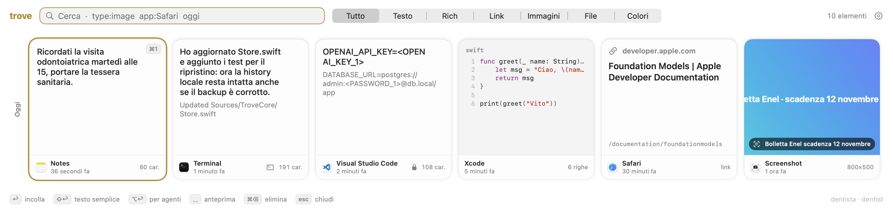

# Trove

A clipboard history manager for macOS 26. Press **⇧⌘V**, find what you copied, press **↩** to paste it.



- Text, rich text, links, images, files and colors, with the source app
- Search by words, by text inside images (OCR) and by meaning, on-device (uses Apple Intelligence when available)
- Filters: `type:image`, `app:Safari`, `today`
- **⌥↩** pastes a cleaned-up version: terminal artifacts removed, secrets replaced by placeholders like `<OPENAI_KEY_1>`
- Pasting into the ChatGPT, Claude, Perplexity or Gemini desktop apps masks API keys, tokens, passwords, cards and IBANs automatically
- Images pasted into a terminal become a file path
- Optional backup to Google Drive for desktop (`My Drive/Trove`)
- English and Italian UI

Everything stays on your Mac, in `~/Library/Application Support/Trove`.

## Install

1. Download `Trove-<version>.dmg` from [Releases](https://github.com/cannoloops/trove/releases) and drag Trove to Applications.
2. Trove is not signed with an Apple Developer ID yet, so macOS blocks the first launch. Either open it once, then go to **System Settings › Privacy & Security** and click **Open Anyway**, or run:
   ```bash
   xattr -dr com.apple.quarantine /Applications/Trove.app
   ```
3. Grant **Accessibility** when asked (System Settings › Privacy & Security › Accessibility): Trove needs it to paste into the frontmost app.

Trove checks for updates by itself (menu bar icon › Check for Updates…). Because builds are not Developer ID signed, macOS may forget the Accessibility permission after an update: if pasting stops working, remove Trove from the Accessibility list and add it again.

Requires macOS 26 on Apple silicon.

## Usage

Press **⇧⌘V** (configurable in Settings) to open the panel over the current app.

| Key | Action |
|---|---|
| ← → | Move the selection |
| ↩ | Paste into the app you were using |
| ⇧↩ | Paste as plain text |
| ⌥↩ | Paste cleaned up and without secrets ([details](docs/guide.md#smart-paste)) |
| ⌘1 … ⌘9 | Paste the n-th result (add ⇧ for plain text) |
| Space | Preview (when the search field is empty) |
| ⌘C | Copy without pasting |
| ⌘⌫ | Delete the selected item |
| ⌘, | Settings |
| Esc | Close the preview, clear the search, then hide the panel |

Type to search. Words can be combined with filters:

| Filter | Example |
|---|---|
| `type:` `text`, `link`, `image`, `file`, `color` | `type:image invoice` |
| `app:` source app | `app:safari` |
| `today`, `yesterday`, `week`, `month` | `password reset week` |

Search is typo-tolerant and ignores accents. It also matches text recognized inside images and, when the semantic index is ready, things with a similar meaning ("receipt" finds "invoice"). Italian filter names (`tipo:`, `oggi`, `ieri`, `settimana`, `mese`) work too.

More in the [user guide](docs/guide.md): smart paste, secrets, backup and restore, privacy, troubleshooting and uninstalling.

## Build from source

Requires Xcode 26 (Swift 6.2).

```bash
swift test
./scripts/build.sh --open
```

`build.sh` creates `build/Trove.app`, and `--install`/`--open` copy it to `/Applications`. Builds are ad-hoc signed, so macOS asks for Accessibility again after each rebuild. To avoid that, run `./scripts/make-cert.sh` once: it creates a local self-signed identity in a dedicated keychain, and `build.sh` uses it from then on. `SIGN_IDENTITY="Developer ID Application: …"` signs with a real identity.

## Release

Push a tag and the [Release workflow](.github/workflows/release.yml) builds, tests and publishes `Trove-<version>.dmg` plus the Sparkle `appcast.xml`:

```bash
git tag v1.0.0 && git push origin v1.0.0
```

It needs the `SPARKLE_ED_PRIVATE_KEY` repository secret (the EdDSA key from Sparkle's `generate_keys -x`), plus `SIGN_CERT_P12` (base64 of the self-signed "Trove Release Signing" `.p12`) and `SIGN_CERT_PASSWORD`. Never replace that certificate: a different one makes macOS revoke Accessibility for every user. The matching public key is `SUPublicEDKey` in `Resources/Info.plist`. Locally: `VERSION=1.0.0 ./scripts/release.sh`.

## License

[MIT](LICENSE)
