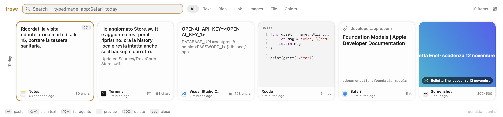
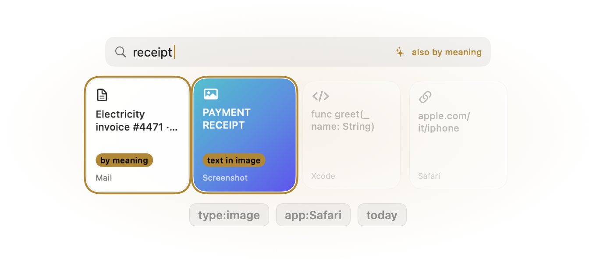
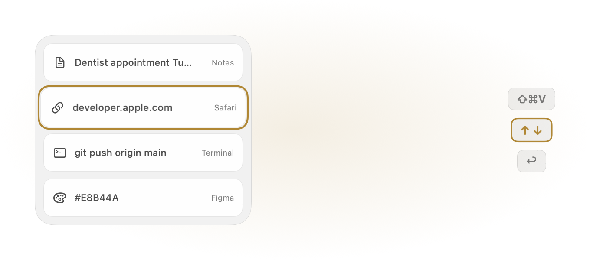
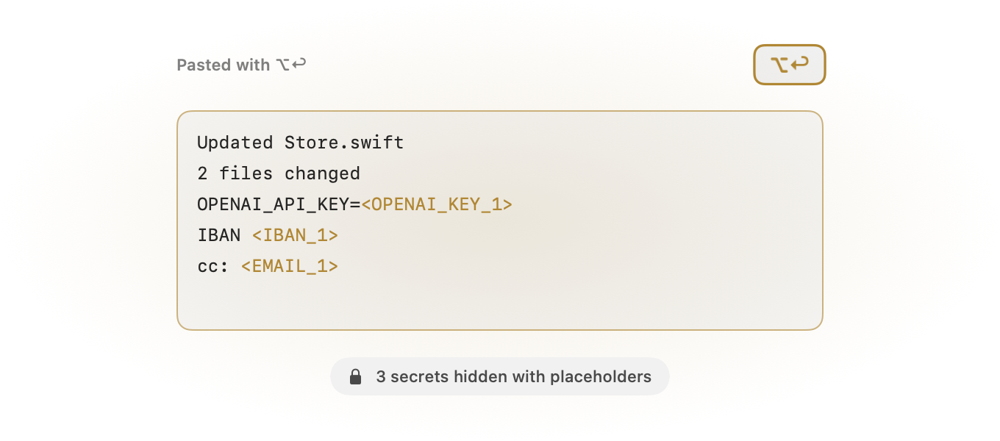
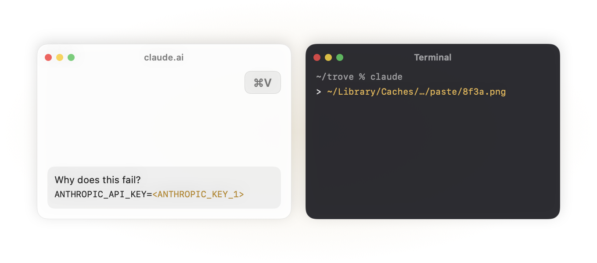

# Trove

A clipboard history manager for macOS 26. Press **⇧⌘V**, find what you copied, press **↩** to paste it.


<picture>
  <source media="(prefers-color-scheme: dark)" srcset="docs/screenshots/panel-dark.png">
  
</picture>

Everything stays on your Mac, in `~/Library/Application Support/Trove`. A short tutorial opens on first launch; you can reopen it from **Settings › General › Show Tutorial Again**.

## Find it the way you remember it

<picture>
  <source media="(prefers-color-scheme: dark)" srcset="docs/screenshots/search-dark.png">
  
</picture>

Text, rich text, links, images, files and colors, with the app they came from. Search by words, by meaning and by the text inside images, all on-device (with Apple Intelligence when available). Filters narrow it down: `type:image`, `app:Safari`, `today`.

## Paste without the mouse

<picture>
  <source media="(prefers-color-scheme: dark)" srcset="docs/screenshots/keyboard-dark.png">
  
</picture>

The panel opens from the side of the screen you choose in Settings (right by default). Move with ↑ ↓ (← → when it sits at the top or bottom), press ↩ to paste into the app you were using.

## ⌥↩ pastes the clean version

<picture>
  <source media="(prefers-color-scheme: dark)" srcset="docs/screenshots/clean-dark.png">
  
</picture>

Terminal artifacts are stripped, and API keys, passwords, card numbers, IBANs, Italian tax codes and VAT numbers, email addresses and Italian phone numbers become placeholders like `<OPENAI_KEY_1>`.

## AI chats and terminals

<picture>
  <source media="(prefers-color-scheme: dark)" srcset="docs/screenshots/agents-dark.png">
  
</picture>

- Pasting with Trove (↩) into the ChatGPT, Codex, Claude, Perplexity or Gemini apps masks secrets automatically (you can turn this off in Settings › AI and agents).
- Pasting with ⌘V into those apps, or into their websites in Safari, Chrome, Arc, Brave, Edge or Firefox, offers to hide what Trove recognizes.
- On an image, ⌥↩ pastes the file path and ⇧↩ the recognized text; images pasted into a terminal become the path.

Also: optional backup to Google Drive for desktop (`My Drive/Trove`), light and dark themes, English and Italian UI.

## Install

1. Download `Trove-<version>.dmg` from [Releases](https://github.com/cannoloops/trove/releases) and drag Trove to Applications.
2. Trove is not signed with an Apple Developer ID yet, so macOS blocks the first launch. Either open it once, then go to **System Settings › Privacy & Security** and click **Open Anyway**, or run:
   ```bash
   xattr -dr com.apple.quarantine /Applications/Trove.app
   ```
3. When asked, allow Trove in **System Settings › Privacy & Security › Accessibility**. It needs this to paste into the frontmost app.

Trove checks for updates automatically (menu bar icon › Check for Updates…). Starting with 1.0.1, every release is signed with the same certificate, so the Accessibility permission survives updates. The one exception is updating from 1.0.0: macOS drops the permission, so if pasting stops working, remove Trove from the Accessibility list and add it again.

Requires macOS 26 on Apple silicon.

## Usage

Press **⇧⌘V** (configurable in Settings) to open the panel over the current app. You can also change the side it opens from in Settings.

| Key | Action |
|---|---|
| ↑ ↓ or ← → | Move the selection (depends on the panel position) |
| ↩ | Paste into the app you were using |
| ⇧↩ | Paste as plain text |
| ⌥↩ | Paste cleaned up and without secrets ([details](docs/guide.md#smart-paste)) |
| ⌘1 … ⌘9 | Paste result 1–9 (add ⇧ for plain text) |
| Space | Preview (when the search field is empty) |
| ⌘C | Copy without pasting |
| ⌘⌫ | Delete the selected item |
| ⌘, | Settings |
| Esc | Close the preview, then clear the search, then hide the panel (one step per press) |

Type to search. Words can be combined with filters:

| Filter | Example |
|---|---|
| `type:` `text`, `link`, `image`, `file`, `color` | `type:image invoice` |
| `app:` source app | `app:safari` |
| `today`, `yesterday`, `week`, `month` | `password reset week` |

Search is typo-tolerant and ignores accents. It also matches text recognized inside images and, when the semantic index is ready, things with a similar meaning ("receipt" finds "invoice"). Click **by meaning** in the search field to also look for synonyms and related words with Apple Intelligence; it takes about a second and only runs when you ask. Italian filter names (`tipo:`, `oggi`, `ieri`, `settimana`, `mese`) work too. Exact matches come first, then items containing all the words, then near matches. Put the query in quotes ("enel invoice") to see only exact matches.

More in the [user guide](docs/guide.md): smart paste, secrets, backup and restore, privacy, troubleshooting and uninstalling.

## Build from source

Requires Xcode 26 (Swift 6.2).

```bash
swift test
./scripts/build.sh --open
```

`build.sh` creates `build/Trove.app`, and `--install`/`--open` copy it to `/Applications`. Builds are ad-hoc signed, so macOS asks for Accessibility again after each rebuild. To avoid that, run `./scripts/make-cert.sh` once: it creates a local self-signed identity in a dedicated keychain, and `build.sh` uses it from then on. `SIGN_IDENTITY="Developer ID Application: …"` signs with a real identity.

## Release

Push a tag and the [Release workflow](.github/workflows/release.yml) builds, tests and publishes `Trove-<version>.dmg` plus the Sparkle `appcast.xml`:

```bash
git tag v1.0.0 && git push origin v1.0.0
```

It needs the `SPARKLE_ED_PRIVATE_KEY` repository secret (the EdDSA key from Sparkle's `generate_keys -x`), plus `SIGN_CERT_P12` (base64 of the self-signed "Trove Release Signing" `.p12`) and `SIGN_CERT_PASSWORD`. Never replace that certificate: a different one makes macOS revoke Accessibility for every user. The matching public key is `SUPublicEDKey` in `Resources/Info.plist`. Locally: `VERSION=1.0.0 ./scripts/release.sh`.

## Support

If Trove saves you time, you can [sponsor its development](https://github.com/sponsors/cannoloops).

## License

[GPL-3.0](LICENSE)
